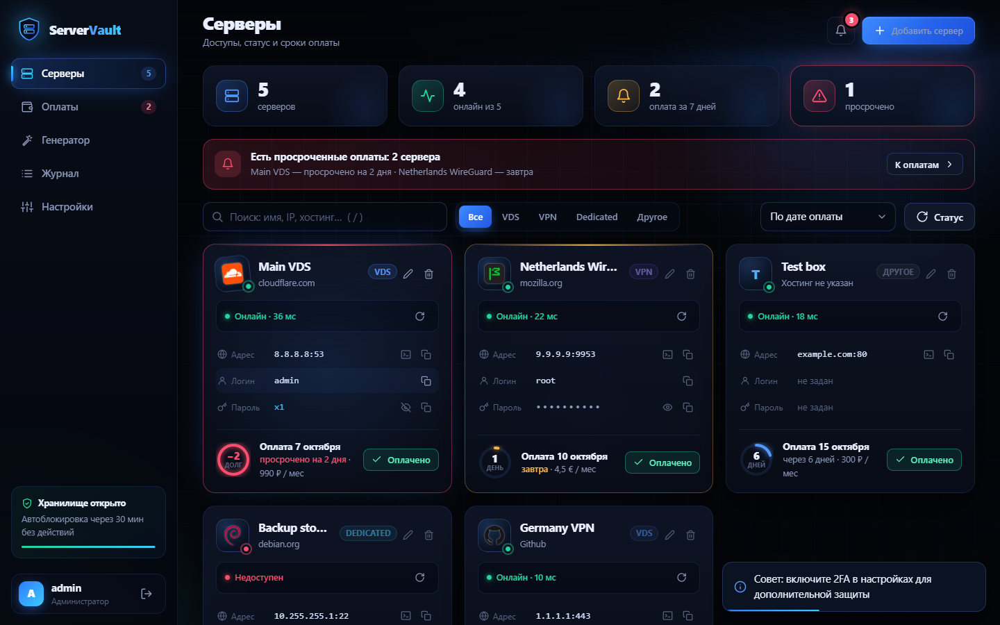
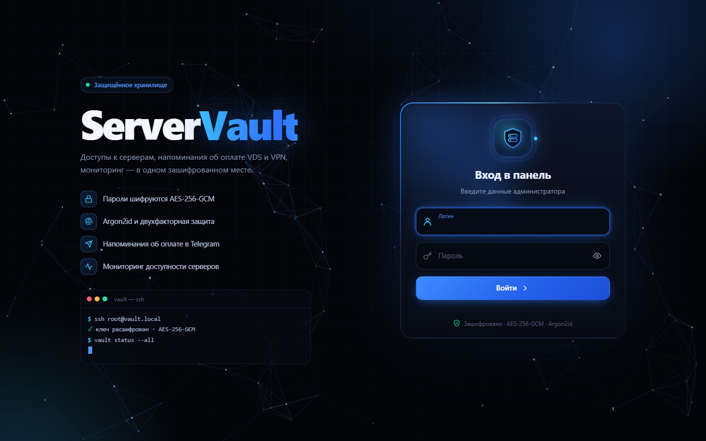
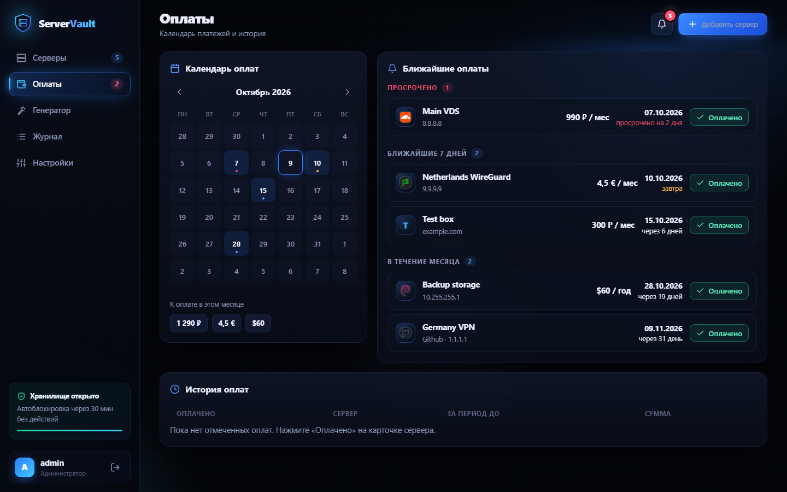
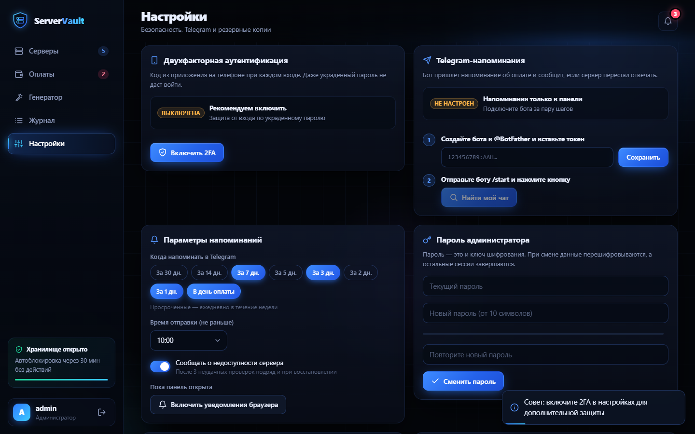
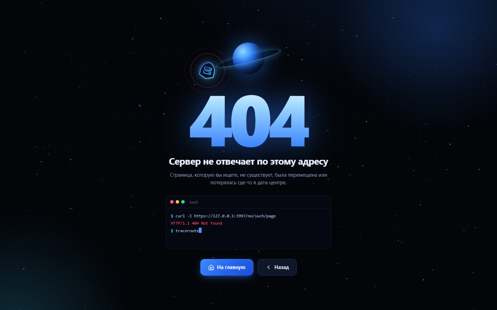

# ServerVault

Self-hosted панель для хранения доступов к серверам (VDS, VPN, dedicated) с напоминаниями об оплате, мониторингом доступности и сильной защитой данных. Чёрно-синий интерфейс с анимациями, полностью на русском.



## Возможности

- **Доступы к серверам**: IP или домен, порт, логин, пароль и заметки. Пароль виден только по клику и скрывается сам через 20 секунд. SSH-команда копируется в один клик.
- **Иконка хостинга подтягивается сама**: вводите адрес сайта (например, `aeza.net`), панель находит favicon и название хостинга.
- **Напоминания об оплате**: в панели (баннер, колокольчик, цветные кольца со сроком, уведомления браузера) и в **Telegram** (по умолчанию за 7, 3 и 1 день и в день оплаты, просроченные — ежедневно). Кнопка «Оплачено» сдвигает дату на следующий период и пишет историю.
- **Календарь оплат** с суммами за месяц по валютам и история платежей.
- **Мониторинг**: TCP-проверка порта каждую минуту, пинг в мс, мини-график, оповещение в Telegram при падении и восстановлении сервера.
- **Генератор паролей** на `crypto.getRandomValues` с оценкой стойкости.
- **2FA** (TOTP: Google Authenticator, Aegis, 2FAS и др.) и 10 одноразовых резервных кодов.
- **Журнал действий**: входы, неудачные попытки, просмотры паролей, изменения.
- **Активные сессии** с возможностью завершить чужие.
- **Зашифрованный бэкап**: экспорт и импорт всех данных одним файлом `.svbak`.
- Страница входа, первичная настройка и анимированная страница 404. Интерфейс адаптирован под телефон.

| Вход | Оплаты |
|---|---|
|  |  |
| **Настройки** | **404** |
|  |  |

## Безопасность

| Угроза | Защита |
|---|---|
| Утечка файла базы данных | Логины, пароли, заметки и секрет 2FA зашифрованы **AES-256-GCM**. Ключ данных (DEK) хранится в БД только зашифрованным ключом из пароля администратора (**Argon2id** 64 МБ, 3 прохода → HKDF). Без пароля база бесполезна, даже вместе с `.env`. |
| Подбор пароля | Argon2id, лимит 10 попыток за 15 минут с одного IP, блокировка аккаунта после 20 неудач, одинаковый ответ и одинаковое время для несуществующего логина. |
| Кража пароля | Двухфакторная аутентификация TOTP с защитой от повторного использования кода и резервными кодами (в БД хранятся только хеши). |
| Захват сессии | Ключ сессии — 256 бит, cookie `HttpOnly` + `SameSite=Strict` (+ `Secure` по HTTPS). Сессии и ключ расшифровки живут **только в памяти**: перезапуск сервера = выход всех. Автовыход через 30 минут бездействия, максимум 12 часов. |
| CSRF | CSRF-токен в заголовке для всех изменяющих запросов, проверка `Origin` и `Sec-Fetch-Site`. |
| XSS | Строгий CSP без `unsafe-inline` для скриптов. Фронтенд вставляет пользовательские данные только через `textContent`. Иконки отдаются с `sandbox`-CSP. |
| SSRF через «сайт хостинга» | Только http/https на 80/443. Каждый DNS-ответ проверяется в момент соединения (защита от DNS-rebinding): запрещены приватные, loopback, link-local и metadata-адреса. Ограничены редиректы, размер и время. Тип картинки определяется по сигнатуре байтов. |
| SQL-инъекции | Только параметризованные запросы. |
| Кликджекинг, утечки через Referer | `X-Frame-Options: DENY`, `frame-ancestors 'none'`, `Referrer-Policy: no-referrer`, `noindex`. |
| Захват свежей установки | Первого администратора можно создать только с одноразовым токеном, который выводится в консоль сервера. |
| Опасные действия | Отключение 2FA, смена пароля, новые резервные коды и импорт с заменой данных требуют повторного ввода пароля. |

> ⚠️ **Пароль администратора — это ключ шифрования.** Если его забыть, сохранённые доступы восстановить невозможно. Регулярно делайте зашифрованный бэкап (Настройки → Резервная копия).

## Запуск

Нужен **Node.js 24.7+**: используются встроенные `node:sqlite` и `crypto.argon2`, нативных зависимостей нет.

```bash
git clone https://github.com/xbob-iio/server-vault-panel.git
cd server-vault-panel
npm install
npm start
```

Откройте <http://127.0.0.1:3000>. При первом запуске в консоли появится **токен установки**. Введите его на странице входа и создайте администратора (пароль от 10 символов).

Настройки задаются в `.env` (пример в [.env.example](.env.example)): порт, адрес, таймауты сессий, частота мониторинга. Данные лежат в папке `data/`. Её нельзя коммитить, но нужно бэкапить.

### Telegram-напоминания

1. Создайте бота у [@BotFather](https://t.me/BotFather) и скопируйте токен.
2. В панели откройте «Настройки» → «Telegram-напоминания», вставьте токен и нажмите «Сохранить».
3. Отправьте боту `/start` и нажмите «Найти мой чат». Придёт подтверждение.

### Доступ из интернета (VPS)

Панель по умолчанию слушает только `127.0.0.1`. Наружу её публикуют через reverse-proxy с HTTPS, например [Caddy](https://caddyserver.com/), который сам получает сертификат:

```caddy
vault.example.com {
    reverse_proxy 127.0.0.1:3000
}
```

В `.env` задайте:

```env
TRUST_PROXY=loopback
SECURE_COOKIES=true
```

Для автозапуска подойдёт systemd или `pm2 start server/index.js --name servervault`. Дополнительно можно ограничить доступ по IP или поставить панель за VPN или WireGuard.

## Стек

- **Бэкенд:** Node.js, Express 5, встроенный SQLite (`node:sqlite`), `crypto` (Argon2id, AES-GCM, HKDF), `qrcode`. Из сторонних пакетов только `express` и `qrcode`.
- **Фронтенд:** чистый JavaScript (ES-модули) и CSS без сборки. Анимации на CSS, Canvas и Web Animations API, учитывается `prefers-reduced-motion`.

```
server/          API, криптография, сессии, мониторинг, напоминания, бэкап
  routes/        auth (вход, 2FA, сессии), servers, system (настройки, Telegram, журнал, бэкап)
public/          login.html, app.html, 404.html
  assets/js/     lib.js (DOM, API, модалки), views/* (разделы панели)
  assets/css/    base.css (дизайн-система), app.css, login.css, 404.css
```

## Лицензия

MIT
